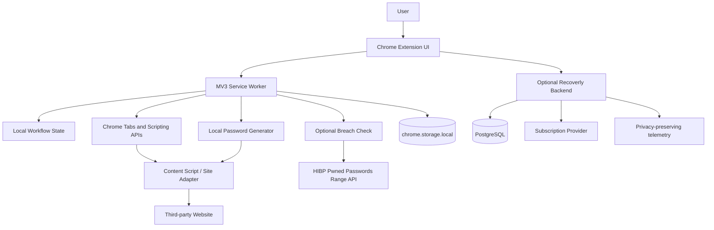
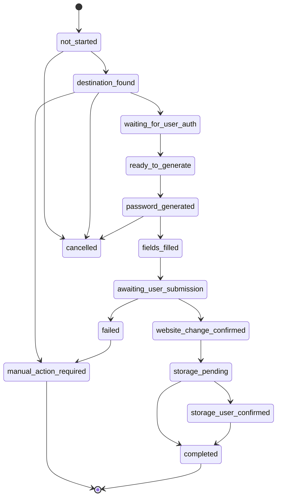

# Recoverly — System Architecture

**Document type:** Engineering architecture specification  
**Status:** Implementation baseline  
**Product:** Recoverly — guided account-security recovery assistant  
**Primary target:** Chrome desktop extension (Manifest V3)  
**Important:** This specification deliberately does not assume privileged access to Google Password Manager.

## 1. Product objective

Recoverly helps a user remediate at-risk online accounts by guiding them through a safe, user-approved password-change workflow. It can discover supported password-change pages, generate unique passwords locally, assist with form completion where permitted, and guide the user through saving the new credential in their existing password manager.

Recoverly is **not** a password vault, credential broker, account-recovery bypass, or unattended password-changing bot.

### 1.1 Core workflow

1. User installs the extension and reviews permissions.
2. User adds an account manually or imports a supported password-manager export locally.
3. Recoverly records account metadata and risk status, never the plaintext password.
4. User selects an account and starts recovery.
5. Recoverly opens a validated password-change destination.
6. User authenticates and completes MFA/CAPTCHA/email/SMS verification themselves.
7. Recoverly generates a unique password locally.
8. User explicitly approves filling the new-password fields.
9. User submits the website's form.
10. Recoverly detects a supported success signal or asks the user to confirm.
11. Chrome or the user's password manager may offer to save/update the credential.
12. User confirms storage; Recoverly records the status separately from the website-change status.

## 2. Non-negotiable platform constraints

- There is no supported public Chrome Extension API for reading, enumerating, or directly editing Google Password Manager's saved-password vault.
- Do not scrape `chrome://password-manager`, `chrome://settings/passwords`, internal Chrome pages, browser profile databases, SQLite files, or undocumented Chrome internals.
- Do not claim that a password was saved merely because a website accepted a password change.
- Chrome may display its native save/update prompt after a successful form submission, but an extension cannot reliably force or programmatically confirm that prompt through a supported API.
- Do not intercept, read, store, or transmit a user's existing password unless a narrowly scoped, user-initiated import flow requires parsing a local export. If import is implemented, parse locally, never upload it, and discard plaintext immediately after deriving metadata.
- Do not automate CAPTCHA, MFA, OTP, recovery codes, security-question answers, or other identity-verification challenges. Pause and hand control to the user.
- Website automation is inherently brittle. Support a small, tested set of adapters and provide a safe manual fallback.
- Never submit a password-change form without an explicit user action immediately beforehand.

## 3. High-level architecture



The backend is optional for the core recovery flow. The extension must remain useful when the backend is unavailable.

## 4. Recommended repository layout

```text
recoverly/
├── apps/
│   ├── extension/
│   │   ├── public/
│   │   │   └── manifest.json
│   │   ├── src/
│   │   │   ├── background/
│   │   │   ├── content/
│   │   │   ├── adapters/
│   │   │   ├── sidepanel/
│   │   │   ├── popup/
│   │   │   ├── options/
│   │   │   ├── components/
│   │   │   ├── hooks/
│   │   │   ├── services/
│   │   │   ├── domain/
│   │   │   ├── storage/
│   │   │   ├── security/
│   │   │   └── tests/
│   │   └── vite.config.ts
│   ├── web/                    # Optional marketing/account portal
│   └── api/                    # Optional backend
├── packages/
│   ├── shared-types/
│   ├── password-core/
│   ├── adapter-contracts/
│   └── test-fixtures/
├── docs/
│   ├── architecture.md
│   ├── features.md
│   └── rules.md
├── infra/
├── .github/workflows/
├── package.json
└── README.md
```

A monorepo is recommended. Use pnpm workspaces or npm workspaces. Keep extension-specific code separate from backend code.

## 5. Extension architecture

### 5.1 Technology

- Chrome Extension Manifest V3.
- TypeScript with strict mode.
- React for popup, side panel, and options UI.
- Vite for extension bundling.
- Chrome APIs through typed wrappers.
- Vitest for unit tests.
- Playwright for end-to-end tests using Chromium.
- Tailwind CSS or CSS Modules; choose one and apply consistently.

### 5.2 Extension components

**Popup**
- Small status summary.
- Shortcut to open the full side panel.
- No sensitive values displayed by default.

**Side panel**
- Main dashboard and recovery workflow.
- Account list, filters, progress, and guided steps.
- Accessible, responsive desktop layout.

**Options**
- Privacy controls.
- Permissions explanation.
- Data export/deletion.
- Optional account/backend settings.

**Service worker**
- Coordinates workflows and alarms only where necessary.
- Handles messages from extension UI and content scripts.
- Must assume it can be suspended and restarted at any time.
- Persist workflow checkpoints before asynchronous operations.

**Content scripts**
- Run only on a user-approved active tab or explicitly granted supported host.
- Detect page structure and password forms.
- Do not read arbitrary page content.
- Do not read current-password values.
- Fill new-password fields only after explicit user approval.
- Do not click the final submit button automatically in the MVP.

**Site adapters**
- Explicit, versioned modules for known websites.
- Must declare supported domains, expected form fields, success signals, and fallback behavior.
- Validate the exact origin before running.
- No remote executable adapter code.

### 5.3 Minimal permissions

Start with the least privilege. Prefer:
- `storage`
- `activeTab`
- `scripting`
- `sidePanel` if the side panel is used
- `notifications` only if genuinely needed

Avoid broad `<all_urls>` host permissions in the MVP. Use `activeTab` and user-initiated access where possible. If a known adapter needs host permissions, request them contextually and explain why. Do not request `tabs`, `webRequest`, clipboard, or identity permissions without a documented requirement and security review.

## 6. Domain model

Never store plaintext passwords, password hashes for the user's credentials, session cookies, OTPs, recovery codes, or form values.

### 6.1 Account record (local)

```ts
type RiskLevel = "critical" | "high" | "medium" | "low" | "unknown";

type AccountRecord = {
  id: string;                  // random UUID
  domain: string;              // normalized registrable domain
  displayName: string;         // user-editable label
  usernameHint?: string;       // optional masked hint; user-controlled
  riskCategories: Array<"breached" | "reused" | "weak" | "user_reported">;
  riskLevel: RiskLevel;
  source: "manual" | "local_import" | "supported_integration";
  createdAt: string;
  updatedAt: string;
  lastReviewedAt?: string;
};
```

### 6.2 Recovery record (local)

```ts
type RecoveryStatus =
  | "not_started"
  | "destination_found"
  | "waiting_for_user_auth"
  | "ready_to_generate"
  | "password_generated"
  | "fields_filled"
  | "awaiting_user_submission"
  | "website_change_confirmed"
  | "storage_pending"
  | "storage_user_confirmed"
  | "completed"
  | "failed"
  | "manual_action_required"
  | "cancelled";

type RecoveryRecord = {
  id: string;
  accountId: string;
  status: RecoveryStatus;
  destinationUrl?: string;
  adapterId?: string;
  startedAt: string;
  updatedAt: string;
  websiteChangeEvidence?: "adapter_signal" | "user_confirmed";
  storageEvidence?: "user_confirmed" | "not_confirmed";
  failureCode?: string;
};
```

Do not store generated password values in either record. Keep a generated password in memory only for the shortest possible period. Clear UI state when the workflow ends, the tab changes, the user cancels, or the extension restarts.

## 7. Recovery state machine



Rules:
- State transitions must be validated centrally.
- A state must never move from `password_generated` directly to `completed`.
- `website_change_confirmed` and `storage_user_confirmed` are independent facts.
- `completed` requires a website-change confirmation and either user-confirmed storage or an explicitly configured alternative-manager confirmation.
- If storage cannot be confirmed, show “Password changed — saving not confirmed”, not “Secured”.

## 8. Password generation and breach checking

### 8.1 Generation

- Use `crypto.getRandomValues()` or Web Crypto APIs.
- Never use `Math.random()`.
- Default to 20 characters; allow 16–64 characters.
- Include configurable character sets.
- Avoid ambiguous characters only when the user chooses that option.
- Ensure generated password satisfies selected character requirements without modulo bias.
- Generate independently for every account.
- Do not use website name, email, username, or other personal data as password entropy.
- Do not log the generated value.

### 8.2 Breach check

Optional Pwned Passwords integration:
- Compute SHA-1 locally solely for API range lookup compatibility.
- Send only the first five hexadecimal characters to the range endpoint.
- Compare returned suffixes locally.
- Never transmit the plaintext password or full hash.
- Apply a clear privacy explanation and allow the user to disable the check.
- Rate-limit requests and handle API errors gracefully.
- Do not describe a password as safe merely because it is absent from the breach corpus.

Use a modern password-strength estimator such as zxcvbn locally. Strength estimation and breach lookup are separate checks.

## 9. Website adapter contract

```ts
export type PasswordFieldMap = {
  newPassword: string;
  confirmPassword?: string;
  currentPassword?: string; // selector only; never read its value
};

export interface PasswordChangeAdapter {
  id: string;
  version: number;
  domains: string[];

  getChangePasswordUrl(origin: string): URL | null;
  detectForm(document: Document): boolean;
  getFieldMap(document: Document): PasswordFieldMap | null;
  detectSuccess(document: Document): boolean;
  getManualInstructions(): string[];
}
```

Security requirements:
- Match exact allowed origins; do not trust a hostname substring.
- Reject non-HTTPS destinations except localhost test fixtures.
- Prevent open redirects and cross-origin navigation confusion.
- Do not use arbitrary selectors received from the backend.
- Adapter code ships with the extension; remote config may disable an adapter but cannot deliver executable code.
- Use explicit tests against local mock websites.
- If detection is uncertain, do not fill fields. Offer manual instructions.
- The user must click a Recoverly action to fill fields.
- The user must click the website's submit button themselves.

## 10. Optional backend architecture

The backend must not be in the password path. It must not receive password values or vault exports.

Recommended stack:
- Node.js + TypeScript (Fastify/NestJS) **or** Laravel. Choose one for MVP, not both.
- PostgreSQL.
- Redis only if needed for rate limits or queues.
- OpenAPI contract.
- Docker for reproducible backend development, but the extension must not require Docker at runtime.
- Hosted secret manager for production secrets.

Backend responsibilities:
- User account and subscription management, if accounts are required.
- Adapter compatibility metadata (non-executable).
- Feature flags and release metadata.
- Privacy-preserving aggregate metrics.
- Support tickets without credentials or sensitive page contents.
- Optional organization licensing.

The extension's core account metadata and recovery history should remain local by default. Cloud sync must be opt-in, clearly described, and limited to non-secret metadata.

### 10.1 Example backend tables

`users`
- id (UUID)
- email
- created_at
- updated_at

`subscriptions`
- id
- user_id
- provider
- provider_customer_id
- status
- plan
- current_period_end

`adapter_catalog`
- id
- domain
- adapter_version
- enabled
- minimum_extension_version
- updated_at

`consent_records`
- id
- user_id
- consent_type
- policy_version
- granted_at
- revoked_at

`aggregate_events`
- id
- event_name
- coarse_platform
- extension_version
- created_at

Do not add columns for passwords, password hashes, OTPs, cookies, recovery codes, or page form values.

## 11. Backend API outline

All endpoints require TLS. Authenticated endpoints use short-lived access tokens and refresh-token rotation if login is implemented.

```text
GET    /api/v1/me
GET    /api/v1/catalog/adapters
GET    /api/v1/releases
GET    /api/v1/subscription
POST   /api/v1/billing/checkout
POST   /api/v1/billing/webhook
POST   /api/v1/consent
DELETE /api/v1/me
POST   /api/v1/telemetry
```

Requirements:
- Validate all inputs with schemas.
- Rate-limit authentication, billing, and telemetry endpoints.
- Verify billing webhook signatures.
- Never accept password, vault-export, OTP, cookie, or credential-form fields.
- Do not include sensitive values in logs or error traces.
- Provide account deletion and consent revocation.
- Define retention periods and document them.

If user accounts and subscriptions are not part of the first release, omit the backend entirely and ship a local-first extension MVP.

## 12. Authentication and authorization

- Do not require a Recoverly account for core local recovery.
- If accounts are added, use a reputable identity provider or secure, standard authentication.
- OAuth scopes must be minimal and must not be presented as a way to access Google Password Manager.
- Never ask users for their Google password.
- Never collect a Google session cookie.
- No credential sharing between Recoverly users or support staff.

## 13. Error handling and resilience

Handle:
- Unsupported website.
- No password-change route.
- User not authenticated.
- MFA/CAPTCHA required.
- Password policy rejection.
- Form not detected.
- Website layout changed.
- Navigation interrupted.
- Extension service worker suspended.
- Chrome save prompt not shown.
- Backend unavailable.
- Breach API unavailable.

Errors must be actionable, non-technical where possible, and must not expose secrets. Always preserve a safe manual path.

## 14. Observability

Permitted telemetry, only with clear consent:
- Feature used.
- Adapter ID and version.
- Workflow state transitions.
- Failure code.
- Extension version.
- Coarse browser version.

Never collect:
- Passwords or password hashes.
- Full URLs containing query strings or tokens.
- Page text or screenshots by default.
- Form field values.
- Account usernames or email addresses.
- Cookies, OTPs, or recovery codes.

Prefer local diagnostics and an exportable redacted debug report.

## 15. Deployment and release

- Build reproducible extension bundles.
- Pin dependencies and enable automated vulnerability scanning.
- Generate an SBOM for release builds.
- Sign and protect backend deployment artifacts.
- Use separate development, staging, and production environments.
- Publish through Chrome Web Store review.
- Maintain a security contact and vulnerability disclosure process.
- Have a rollback mechanism for broken adapters.
- Keep a supported-browser and supported-adapter matrix.

## 16. Definition of done

The architecture is acceptable only when:
- No password value leaves the browser.
- No privileged Google Password Manager access is assumed.
- Permission requests are minimal and explained.
- Every recovery transition is tested.
- User submission is required.
- Password-save confirmation is not fabricated.
- Unsupported workflows fall back safely.
- Extension restart does not corrupt recovery state.
- Security tests pass.
- Privacy disclosures match actual telemetry and data flows.
